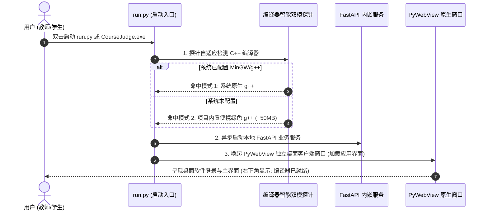
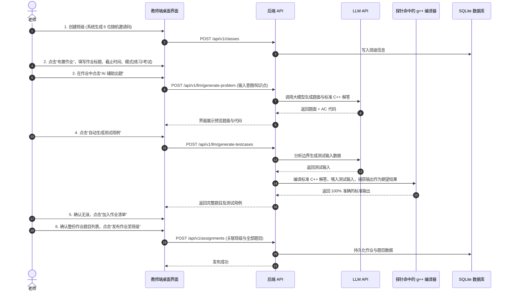
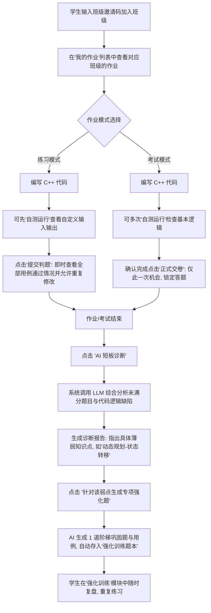

# 智能代码判题与教学辅助系统 (CourseJudge) - 业务接口与流程规范

## 1. 核心业务流程流转

### 1.1 系统启动与编译器自适应探针流程



---

### 1.2 老师：班级管理 $\to$ 智能出题编排 $\to$ 发布作业



---

### 1.3 学生：作业做题 $\to$ 考后短板一键诊断 $\to$ 专属强化训练题本



---

## 2. 核心 RESTful API 规范

### 2.1 系统健康与探针状态 (`/api/v1/system`)

| 请求方法 | 路径 | 功能描述 | 返回数据示例 |
| :--- | :--- | :--- | :--- |
| `GET` | `/status` | 获取系统健康与编译器探针状态 | `{"compiler_mode": "builtin", "compiler_path": "...", "db_connected": true, "version": "1.0.0"}` |

---

### 2.2 班级管理模块 (`/api/v1/classes`)

| 请求方法 | 路径 | 权限 | 功能描述 | 核心参数说明 |
| :--- | :--- | :--- | :--- | :--- |
| `POST` | `/` | 教师 | 创建新班级 | `name`: 班级名称；系统自动生成 6 位 `invite_code` |
| `GET` | `/my` | 教师/学生 | 获取当前用户所属的班级列表 | 教师返回自己创建的班级，学生返回已加入的班级 |
| `POST` | `/join` | 学生 | 通过 6 位邀请码加入班级 | `invite_code`: 班级邀请码 |
| `GET` | `/{id}/students` | 教师 | 查看班级内所有已加入学生 | Path: `id` |

---

### 2.3 作业与题目管理模块 (`/api/v1/assignments`)

| 请求方法 | 路径 | 权限 | 功能描述 | 核心参数说明 |
| :--- | :--- | :--- | :--- | :--- |
| `POST` | `/` | 教师 | 发布作业/考试 | `class_id`, `title`, `type` (`practice`/`exam`), `start_time`, `end_time`, `problems` 数组 |
| `GET` | `/class/{class_id}` | 学生/教师 | 获取某班级下的全部作业列表 | 区分待开始、进行中、已截止 |
| `GET` | `/{id}` | 学生/教师 | 获取作业详情与题目清单 | 考试未开始前只展示倒计时 |
| `GET` | `/{id}/dashboard` | 教师 | **班级学情与薄弱知识点大屏** | 返回：应交人数、实交人数、平均分、各分数段人数直方图、各题正答率漏斗、薄弱知识点 Top 诊断 |

---

### 2.4 判题与自测模块 (`/api/v1/judge`)

#### 1. 自测运行 (仅编译运行，不判分)
- **请求方式**：`POST /api/v1/judge/run-test`
- **请求体 (Body)**：
  ```json
  {
    "code": "#include <iostream> ...",
    "custom_input": "5\n1 2 3 4 5"
  }
  ```
- **响应体 (Data)**：
  ```json
  {
    "status": "Success",     // Success / Compilation Error / Runtime Error / Time Limit Exceeded
    "output": "15",
    "error_message": "",
    "execution_time_ms": 15
  }
  ```

#### 2. 正式提交判题 (练习/考试提交)
- **请求方式**：`POST /api/v1/judge/submit`
- **请求体 (Body)**：
  ```json
  {
    "assignment_id": 1,
    "problem_id": 10,
    "code": "#include <iostream> ...",
    "is_final_exam_submit": false   // 考试交卷时置为 true
  }
  ```
- **响应体 (Data)**：
  - **练习模式**：返回详细分数、用例通过详情、最大耗时、失败样例类型。
  - **考试模式**：提交成功后返回交卷凭据，界面输入框锁定。

---

### 2.5 学生专属强化训练题本 (`/api/v1/training`)

| 请求方法 | 路径 | 权限 | 功能描述 | 核心参数说明 |
| :--- | :--- | :--- | :--- | :--- |
| `GET` | `/my` | 学生 | 获取个人历史强化训练题列表 | 展示知识点标签、题目名称、历史最佳评测状态 (`AC`/`WA`) |
| `GET` | `/{id}` | 学生 | 查看单道强化题详情 | Path: `id` (题面、输入输出样例) |
| `POST` | `/{id}/submit` | 学生 | 针对专属强化题进行提交判题 | `code`: C++ 源码，返回实时测评结果与得分 |

---

### 2.6 大模型 (LLM API) 核心接口 (`/api/v1/llm`)

#### 1. 教师：智能出题
- **请求方式**：`POST /api/v1/llm/generate-problem`
- **入参**：`{"prompt": "出1道二叉树后序遍历的中等题", "knowledge_tag": "二叉树"}`
- **返回**：标题、题面 Markdown、输入输出样例、标准 C++ 解答代码。

#### 2. 教师：自动生成测试用例
- **请求方式**：`POST /api/v1/llm/generate-testcases`
- **入参**：`{"problem_description": "...", "standard_code": "..."}`
- **机制**：LLM 生成边界输入，后端自动调用编译器运行标准解答并抓取输出，返回 100% 正确配对用例集。

#### 3. 学生：考后一键短板分析
- **请求方式**：`POST /api/v1/llm/diagnose-assignment`
- **入参**：`{"assignment_id": 1}`
- **返回**：`weak_point` 标签、代码逻辑缺陷诊断、解题思路指导。

#### 4. 学生：针对短板生成专属强化训练题
- **请求方式**：`POST /api/v1/llm/generate-training-problem`
- **入参**：`{"assignment_id": 1, "weak_point": "动态规划-状态转移方程"}`
- **返回**：生成 1 道结构化巩固题目及测试用例，并在数据库中自动落库至该学生的专属训练题本。

#### 5. 首页 AI 助手问答 (支持流式 SSE)
- **请求方式**：`POST /api/v1/llm/chat`
- **入参**：`{"message": "请解释一下什么是拓扑排序，它的应用场景有哪些？"}`
- **返回**：流式或标准 Markdown 解答内容。
